# 3 DOCUMENTACIÓN PARA EL USO DEL SOFTWARE

> **Cómo usar este archivo.** Cada operación trae los pasos reales de la interfaz y su captura
> **ya insertada**: las imágenes se ven directamente en la vista previa. Copiá desde la vista previa
> renderizada (`Ctrl+Shift+V`) para que las tablas y las imágenes lleguen al Word.
>
> **Todas las capturas están en** `docs/capturas/uso/` (29 archivos PNG, tomados de la aplicación en
> ejecución y de la evidencia ya registrada; ninguno es un montaje).
>
> **Nombres de la interfaz.** El editor web está en inglés (`Add an element`, `Elements`, `Problems`…)
> y el asistente del teléfono está en español. Los pasos respetan el idioma real de cada pantalla.

---

## 3 Documentación para el uso del software

El software se compone de tres superficies de uso: el **editor web** (`http://localhost:3000`), el
**asistente del teléfono** (aplicación Flutter) y el **backend generado** que produce el propio
editor. Esta sección documenta las dieciséis operaciones de uso con la secuencia real de pasos y la
captura correspondiente.

La generación, descarga, verificación disponible e implementación del backend se manejan desde el panel de generación del editor.

| # | Operación | Capturas |
| --- | --- | --- |
| 1 | Crear y abrir un proyecto de modelado | `01-login.png`, `01-proyectos.png`, `02-clasificadores.png` |
| 2 | Crear clasificadores UML | `02-clasificadores.png` |
| 3 | Agregar atributos, operaciones y parámetros | `07-ia-paso-01.png` |
| 4 | Crear y editar relaciones UML | `07-ia-paso-05.png` |
| 5 | Organizar la disposición visual del diagrama | `05-disposicion.png` |
| 6 | Validar el modelo UML | `06-validacion.png` |
| 7 | Editar el modelo mediante IA por texto | `07-ia-texto.png`, `07-ia-paso-01..07.png` |
| 8 | Procesar un comando de voz | `08-voz.png` |
| 9 | Interpretar una fotografía de un diagrama | `09-foto.png` |
| 10 | Invitar colaboradores y trabajar en tiempo real | `10-miembros.png` |
| 11 | Resolver cambios offline y conflictos | `11-sincronizacion.png` |
| 12 | Importar y exportar XMI con Enterprise Architect | `12-importar-xmi.png`, `12-exportar-xmi.png` |
| 13 | Generar y verificar un backend | `13-health-backend-generado.png` |
| 14 | Consumir el backend desde Flutter | `14-asistente-*.png` (8 capturas) |
| 15 | Utilizar la IA local sin conexión | `15-modelo-en-dispositivo.png`, `14-asistente-plan-pendiente.png` |
| 16 | Ejecutar la demostración integral | `14-asistente-*.png` + evidencia en `tools/e2e-integral/evidence/` |

---

## 1. Crear y abrir un proyecto de modelado

1. Abrir el editor web en `http://localhost:3000`.
2. En la pantalla de inicio de sesión, elegir una cuenta sembrada de desarrollo (por ejemplo
   `Demo User 01`) o escribir las credenciales.
3. La pantalla principal muestra el encabezado *Welcome back* y la lista de proyectos: cada tarjeta
   lleva el nombre del proyecto y su **etiqueta de acceso** legible, nunca el identificador crudo.
4. Pulsar **Open project** en la tarjeta del proyecto. Se abre el editor con la barra de menús
   (`File`, `Edit`, `View`, `Extras`, `Help`), el panel `Add an element`, el lienzo y el panel
   `Problems`.
5. Para volver, los botones **Back to projects** y **Log out** están en la cabecera.

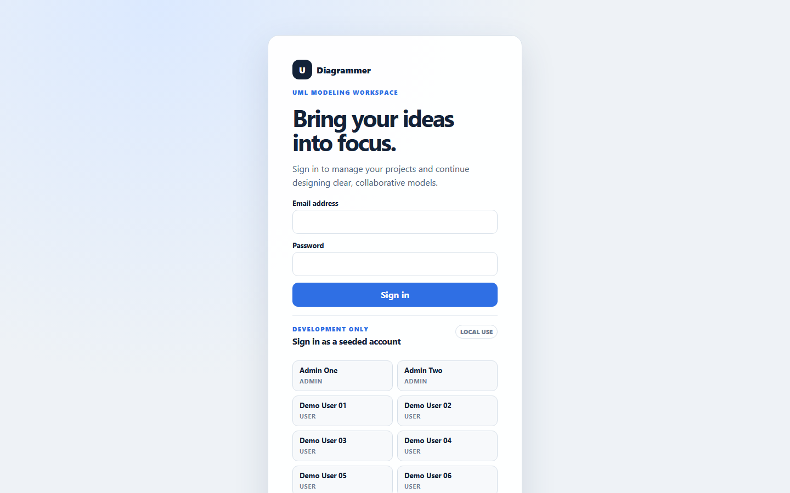

*Figura. Inicio de sesión con las cuentas de desarrollo sembradas.*

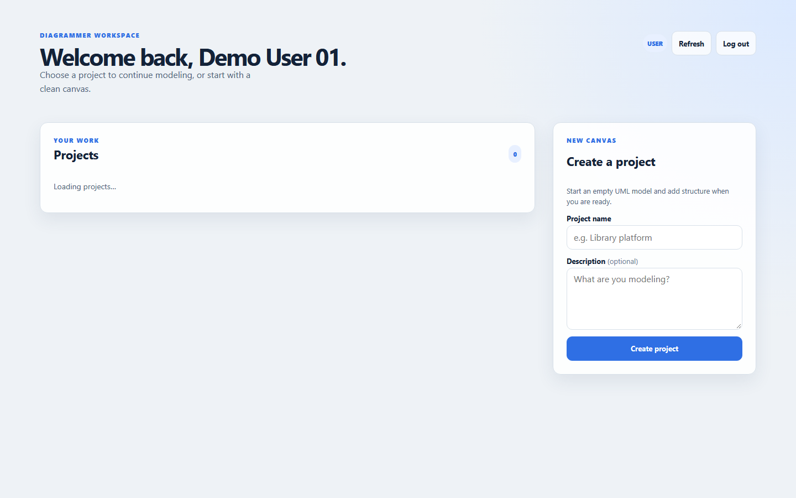

*Figura. Panel de proyectos: cada tarjeta muestra el nombre y la etiqueta de acceso legible.*

---

## 2. Crear clasificadores UML

1. En el panel **Add an element**, elegir el tipo en la paleta: `Class`, `Abstract class`,
   `Interface`, `Value list` (enumeración) o `Folder` (paquete). El panel recuerda la instrucción
   *"Pick a type, then place it on the diagram"*.
2. Colocar el elemento con un clic en el lienzo. La geometría nueva **no se apila** sobre la existente.
3. Renombrar con **doble clic** sobre el nombre del clasificador.
4. El panel **Elements** lista lo que hay en el diagrama (por ejemplo *"2 elements in the diagram."*
   con `Libro — class` y `Autor — class`).
5. La paleta también ofrece **Search shapes** para encontrar un tipo por nombre.

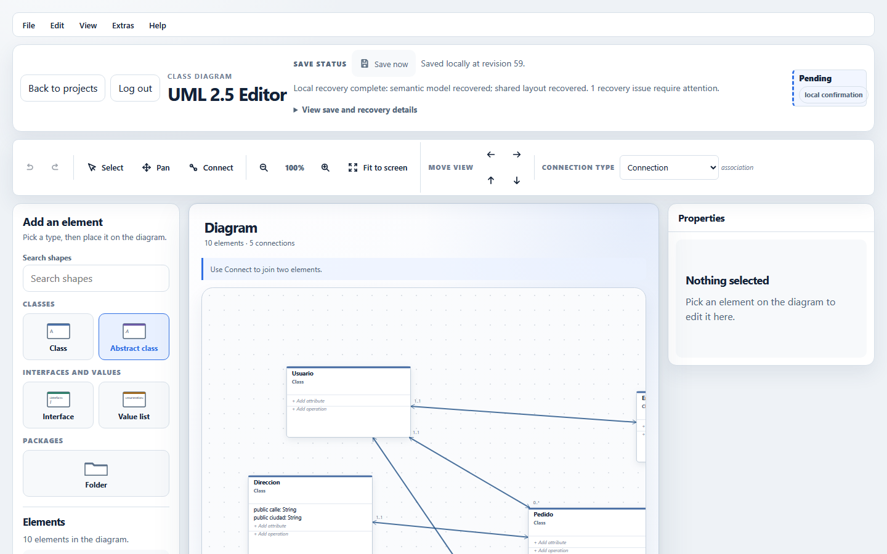

*Figura. Editor abierto: paleta `Add an element` con las secciones `CLASSES`,
`INTERFACES AND VALUES` y `PACKAGES`, lienzo central y panel `Elements`.*

---

## 3. Agregar atributos, operaciones y parámetros

1. **Doble clic en una fila vacía** de la caja del clasificador para añadir un atributo o una
   operación; la caja muestra también las acciones `Add attribute` y `Add operation`.
2. Escribir la firma: `nombre: String`, `anio: Decimal`, `disponible: Boolean`.
3. **Doble clic en una fila con contenido** para editarla; el panel de propiedades permite ajustar
   visibilidad, tipo, multiplicidad, valor predeterminado y miembros estáticos o abstractos.
4. Guardar con **Ctrl + S** (`File → Save now`). El indicador de estado muestra el aviso
   *"Pending — local confirmation"* mientras el servidor confirma la revisión.
5. Con la selección activa se pueden usar **Ctrl + C** (copiar), **Ctrl + V** (pegar),
   **Ctrl + D** (duplicar) y la tecla **Delete** (eliminar); el panel **Copy and paste** expone las
   mismas acciones como botones `Copy selection` y `Paste selection`.

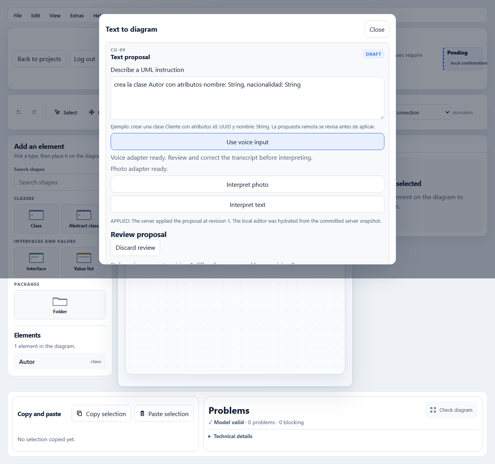

*Figura. Clase `Autor` con los atributos `nombre` y `nacionalidad` y las acciones `Add attribute` y
`Add operation` visibles en la caja del clasificador.*

### Notación UML de clasificadores y miembros

Todo se edita en el panel de propiedades del elemento seleccionado y se dibuja en la caja según UML 2.5:

| Qué | Dónde se elige | Cómo se dibuja |
| --- | --- | --- |
| **Visibilidad** | Lista de visibilidad: público, privado, **Protegido (#)** y **Paquete (~)** | `+`, `-`, `#`, `~` antes del nombre del miembro |
| **Multiplicidad con rango** | Opción **Rango** de la multiplicidad, con los campos **Mínimo** y **Máximo** (máximo vacío = sin límite) | `2..5`, `2..*`, o `3` cuando mínimo y máximo coinciden |
| **Estático** | Casilla **Estático** del atributo | La fila del atributo va subrayada |
| **Derivado** | Casilla **Derivado** del atributo | Barra antes del nombre: `/edad: int` |
| **Estereotipo** | Lista **Estereotipo**, con la opción *(ninguno)*; no se escribe texto libre | `«entity»` sobre el nombre de la clase, o antes del miembro |

Las listas de estereotipos son fijas, para que nadie tenga que conocer el nombre exacto:

- **Clases** (solo clase y clase abstracta): `entity`, `boundary`, `control`, `service`, `utility`, `type`,
  `auxiliary`, `focus`, `implementation_class`, `metaclass` y `signal`. Las interfaces y las enumeraciones ya
  llevan su propia etiqueta, y los paquetes no admiten estereotipo.
- **Operaciones:** `create`, `destroy` y `query`.
- **Atributos** (convenciones de modelado, no estándar de UML): `id`, `unique` y `readonly`.

Un elemento lleva **un solo** estereotipo. Una regla de rango se rechaza si el máximo es menor que el mínimo o
si el mínimo es negativo, y el modelo no cambia.

---

## 4. Crear y editar relaciones UML

1. En la barra de herramientas, elegir el **tipo de conexión** en el selector (arranca en
   `association`; las demás opciones cubren agregación, composición, generalización, realización de
   interfaz y dependencia).
2. Arrastrar desde el clasificador de origen hasta el de destino. Si falta un extremo, la operación se
   rechaza de forma atómica y el modelo no cambia.
3. Editar en el panel de propiedades los extremos de la relación: **rol**, **navegabilidad** y
   **multiplicidad** (`1`, `0..1`, `1..*`, `0..*`).
4. La plataforma acepta **auto-relaciones** y rechaza relaciones con extremos inexistentes sin mutar
   el modelo.

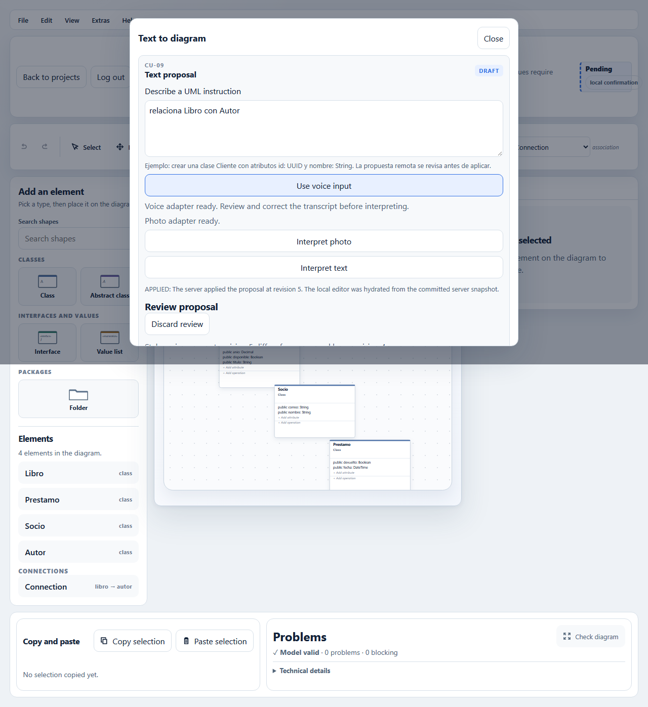

*Figura. Relación creada entre `Libro` y `Autor` a partir de la instrucción *"relaciona Libro con
Autor"*; el lienzo muestra la asociación y el panel de operaciones la registra.*

### Propiedades de los extremos y notas

- **Extremos.** En el panel de propiedades de la relación, cada extremo tiene además las casillas
  **Ordenado** y **Único**. Se dibujan junto a la multiplicidad: `items 0..* {ordered} {unique}`. La
  multiplicidad de cada extremo admite también un **Rango** (`2..5`).
- **Importación de EA.** Al importar un XMI, **Ordenado** se lee del archivo, pero **Único** no: UML define
  `true` como valor por defecto y Enterprise Architect lo escribe en todos los extremos, así que leerlo
  marcaría `{unique}` en todas las relaciones. Sí se escribe al exportar cuando está marcado.
- **Notas.** El botón **Nota** de la barra de herramientas crea una nota; si hay una clase o relación
  seleccionada, nace ya enlazada a ella. Una nota se dibuja como un rectángulo de esquina doblada con
  su texto, y se une con **líneas punteadas** a los elementos que anota. Puede anotar **cero, uno o
  varios** elementos (clases y relaciones). En su panel de propiedades se edita el texto (hasta 2000
  caracteres), se ve la lista **Anota a** con la acción **Quitar**, se agregan enlaces con **Vincular a…**
  y se elimina la nota. Si se borra un elemento anotado, la nota se conserva y pierde solo ese enlace.
  En XMI se exporta como `ownedComment` con sus `annotatedElement`; al importar, las notas llegan sin
  posición en el lienzo.

> **Alcance de la notación.** El editor cubre clases, clases abstractas, interfaces, enumeraciones y
> paquetes, las seis relaciones UML, clase de asociación, visibilidad, rangos, estereotipos, notas,
> miembros estáticos y derivados, y `{ordered}`/`{unique}`. No cubre calificadores, asociaciones n-arias,
> clases plantilla, clases anidadas ni `readOnly`/`isQuery`/`redefines`. El generador de código sigue
> aceptando solo visibilidad pública y privada y rechaza la protegida, la de paquete y los rangos.

---

## 5. Organizar la disposición visual del diagrama

1. Con la herramienta **Select** de la barra de herramientas, mover y redimensionar los elementos.
2. Usar el menú **View** para el encuadre personal: `Zoom in`, `Zoom out`, `Zoom to 100%` y
   `Fit to screen`.
3. Durante el arrastre, la disposición compartida se actualiza de forma coalescida y el bloqueo
   blando evita que dos personas muevan la misma geometría a la vez.
4. El zoom, el encuadre y la selección son **estado personal**; las posiciones y tamaños son
   **disposición compartida**. Mover un elemento nunca modifica atributos, relaciones ni
   identificadores.
5. Con las flechas del teclado y `Delete` se ajusta o elimina la selección.

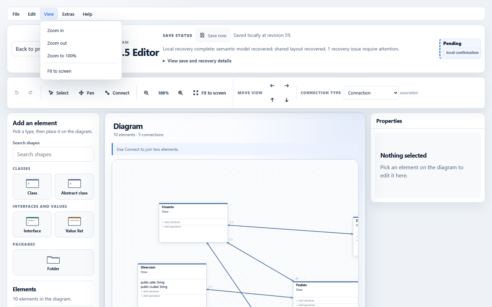

*Figura. Menú `View` desplegado con `Zoom in`, `Zoom out`, `Zoom to 100%` y `Fit to screen`.*

---

## 6. Validar el modelo UML

1. El panel **Problems** muestra el veredicto en una línea:
   *"Model valid · 0 problems · 0 blocking"*. Cuando hay errores, indica cuántos hay y cuántos
   bloquean.
2. El botón **Check diagram** vuelve a validar el diagrama completo.
3. **Technical details** despliega el detalle de cada diagnóstico, con código y severidad.
4. Un error semántico **bloquea la exportación XMI definitiva, la publicación y la generación**; las
   colisiones de nombres quedan visibles y no impiden seguir editando.

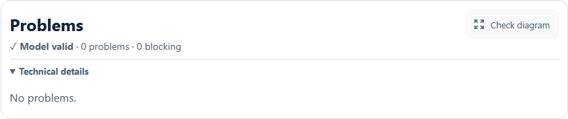

*Figura. Panel `Problems` con `Check diagram`, el veredicto *"Model valid · 0 problems · 0 blocking"*
y el detalle técnico desplegado.*

---

## 7. Editar el modelo mediante IA por texto

1. Menú **Extras → Text to diagram**. Se abre el panel modal rotulado **Text to diagram · CU-09**.
2. Escribir la instrucción en **Describe a UML instruction**; el propio panel sugiere el ejemplo
   *"crea una clase Cliente con atributos id: UUID y nombre: String. La propuesta remota se revisa
   antes de aplicar."*
3. Pulsar **Interpret text**. La propuesta aparece marcada con la insignia **DRAFT** y el detalle de
   las operaciones detectadas.
4. Revisar: se pueden corregir campos permitidos y volver a validar; el botón **Discard review**
   descarta la propuesta sin tocar el modelo.
5. Al aplicar, el panel confirma con
   *"APPLIED: The server applied the proposal at revision N. The local editor was hydrated from the
   committed server snapshot."* El aviso de revisión obsoleta aparece si el modelo cambió mientras se
   revisaba, y nada se sobreescribe en silencio.

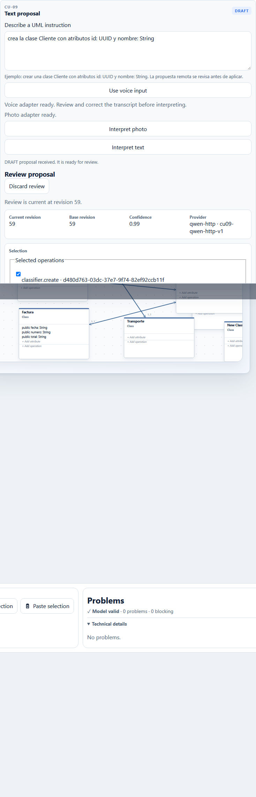

*Figura. Panel `Text proposal` con la instrucción escrita, la insignia `DRAFT`, la revisión en la
revisión 59 del modelo, la confianza `0.99`, el proveedor `qwen-http · cu09-qwen-http-v1` y la
operación `classifier.create` seleccionada.*

**Secuencia completa aplicada por esta vía** (cuatro clases y tres relaciones, del dominio de
biblioteca):

| Paso | Captura |
| --- | --- |
| 1. Crear la clase `Autor` | `07-ia-paso-01.png` |
| 2. Crear la clase `Libro` | `07-ia-paso-02.png` |
| 3. Crear la clase `Socio` | `07-ia-paso-03.png` |
| 4. Crear la clase `Prestamo` | `07-ia-paso-04.png` |
| 5. Relacionar `Libro` con `Autor` | `07-ia-paso-05.png` |
| 6. Relacionar `Prestamo` con `Libro` | `07-ia-paso-06.png` |
| 7. Relacionar `Prestamo` con `Socio` | `07-ia-paso-07.png` |

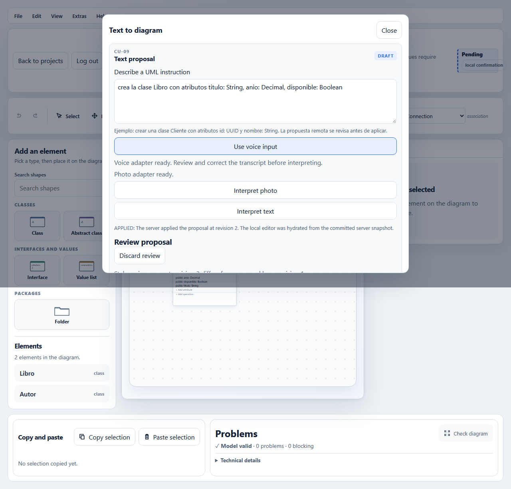

*Figura. Paso 2: la clase `Libro` con `titulo`, `anio` y `disponible` aplicada desde el panel.*

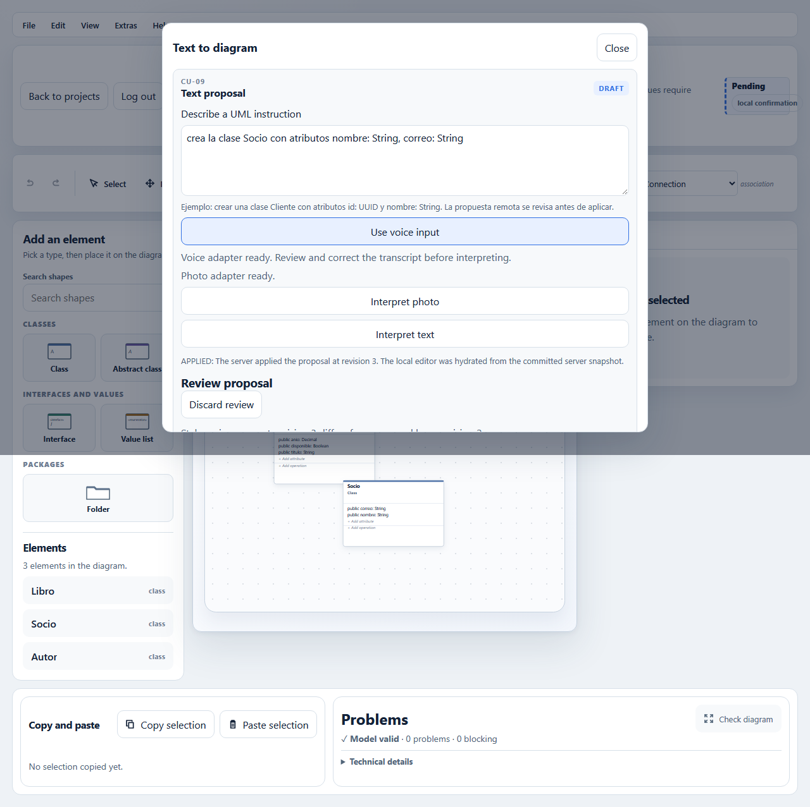

*Figura. Paso 3: la clase `Socio` creada por la misma vía.*

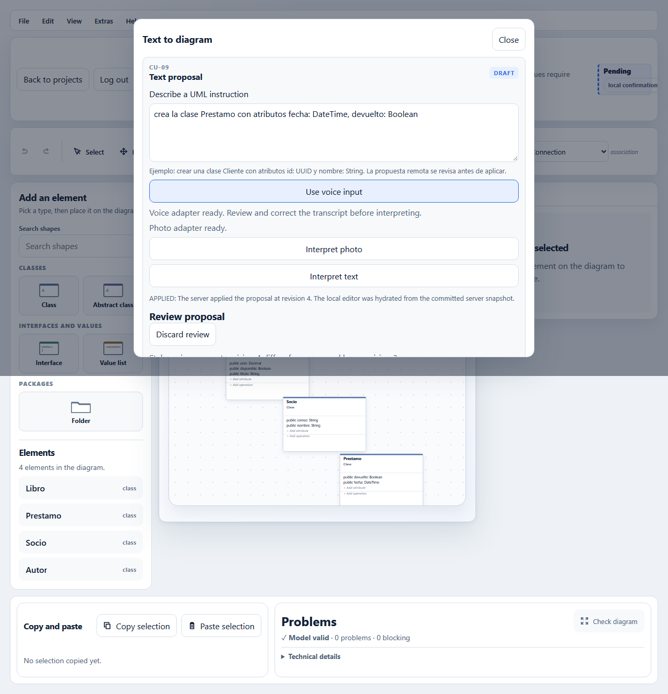

*Figura. Paso 4: la clase `Prestamo` creada por la misma vía.*

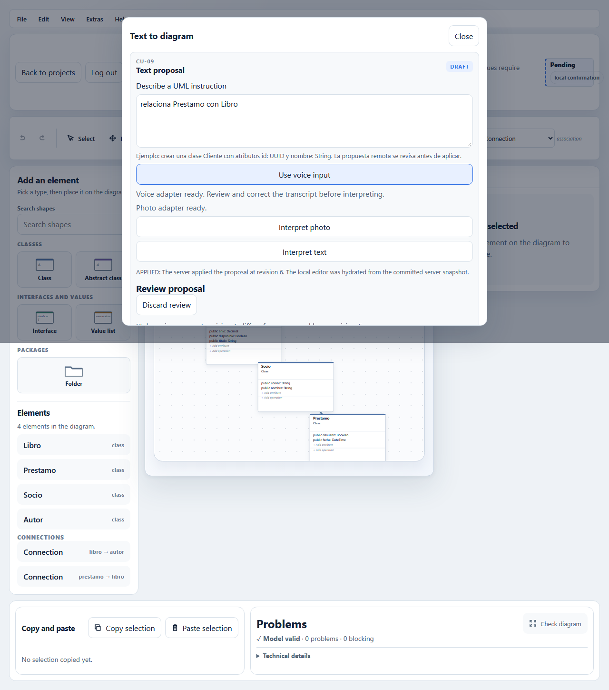

*Figura. Paso 6: relación entre `Prestamo` y `Libro`.*

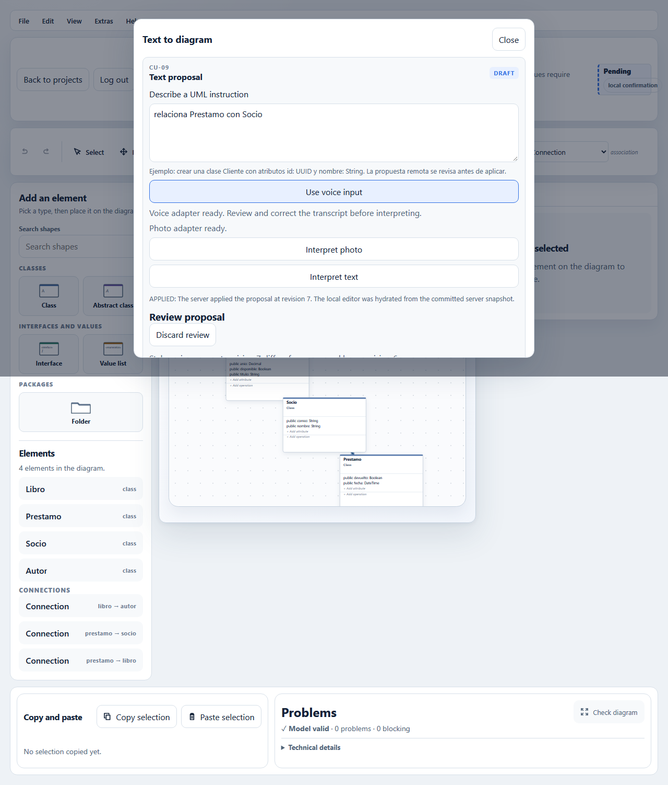

*Figura. Paso 7: relación entre `Prestamo` y `Socio`.*

---

## 8. Procesar un comando de voz

1. En el mismo panel, pulsar **Use voice input**. El panel declara su estado:
   *"Voice adapter ready. Review and correct the transcript before interpreting."*
2. Grabar desde el micrófono o elegir un archivo de audio. El reconocimiento se ejecuta en el
   **ASR local** (`faster-whisper`, en CPU y cuantización int8, idioma `es-ES`) y devuelve la
   transcripción.
3. **Corregir la transcripción** si hace falta: el flujo no continúa hasta que la persona la valida.
4. Pulsar **Interpret text**: la transcripción entra al mismo flujo que la operación 7, así que la
   propuesta se revisa y se confirma igual que un texto escrito.
5. Si no hay reconocedor disponible, la interfaz **lo declara y ofrece seguir escribiendo**; nunca
   simula una voz que no se pudo reconocer.

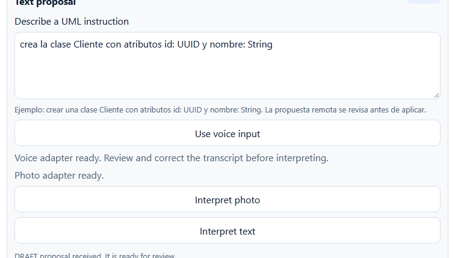

*Figura. Formulario de la asistencia: campo de instrucción, botón `Use voice input` y el estado
declarado del adaptador de voz.*

---

## 9. Interpretar una fotografía de un diagrama

1. Pulsar **Interpret photo** (el panel declara *"Photo adapter ready."*) y elegir la imagen.
2. El sistema devuelve una **propuesta parcial y editable** con clases, atributos y tipos,
   operaciones, relaciones y multiplicidades, además de **cobertura explícita, confianza por
   elemento, faltantes, ambigüedades y disposición aproximada** cuando es observable.
3. Revisar la propuesta en el mismo panel de revisión: se puede **completar y reposicionar el
   diagrama a mano** y decidir qué elementos conservar.
4. Solo los comandos **revisados, confirmados y validados** se incorporan al modelo canónico. Una
   coincidencia dudosa con un elemento existente queda como advertencia y no entra al modelo.
5. Una imagen ilegible produce un diagnóstico y una propuesta sin cobertura útil, **nunca una
   afirmación de completitud**.

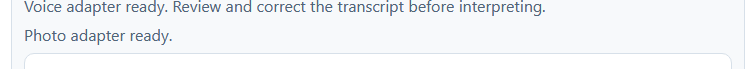

*Figura. Estado del adaptador fotográfico que el panel declara antes de aceptar una imagen.*

**Nota de honestidad para el informe:** el proveedor fotográfico es **opt-in**
(`CU12_PHOTO_QWEN_ENABLED=false` por defecto), así que esta captura muestra el estado del adaptador y
no una propuesta fotográfica real. Para documentar la propuesta completa hay que habilitar el
proveedor y capturar el panel con las secciones `Coverage`, `Extracted facts`, `Approximate layout` y
`Missing parts`.

---

## 10. Invitar colaboradores y trabajar en tiempo real

1. Abrir **File → Project members**.
2. Invitar por correo: el campo ofrece **sugerencias de cuentas** con correo y marca de estado.
3. Asignar el rol del participante. La lista muestra **personas, no identificadores**: nombres
   legibles en lugar de UUID.
4. Con dos sesiones abiertas sobre el mismo proyecto, el panel de presencia muestra quién está
   conectado y los cambios se propagan **sin recargar la página**.
5. El servidor mantiene la autoridad: un permiso revocado se aplica en la siguiente operación aunque
   el cliente lo tuviera en caché.

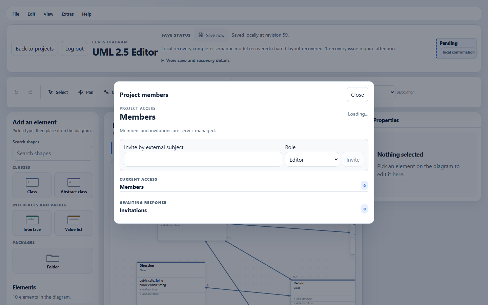

*Figura. Panel `Project members` abierto desde el menú `File`.*

**Evidencia medida:** `tools/web-e2e/REPORT.md` registra **8 de 8 pasos correctos**, incluidos el
inicio de sesión sembrado, el panel de integrantes con etiquetas legibles, la apertura del editor y la
propagación de una edición entre dos sesiones sin recargar.

---

## 11. Resolver cambios offline y conflictos

1. El estado de sincronización se muestra en la **cabecera del editor**: revisión local, revisión del
   servidor y el aviso `Pending — local confirmation` mientras hay cambios sin confirmar.
2. Al perder la conexión, las operaciones quedan en la **cola local**; el editor sigue funcionando y
   muestra el estado `sincronizando` cuando la latencia supera el medio segundo.
3. Al volver la conexión, el cliente reconcilia: se fusionan automáticamente **solo campos
   independientes** cuyas precondiciones se cumplen y siempre que la validación del modelo completo
   pase.
4. Los cambios incompatibles **no entran al canon**: aparecen en el panel de conflictos con las
   alternativas y su historia. Una eliminación gana mediante *tombstone* y su cascada se aplica como
   una única operación atómica.
5. Si el cambio de disposición del servidor no se puede adoptar, el editor **lo avisa en el lienzo**
   en lugar de forzar la vista.

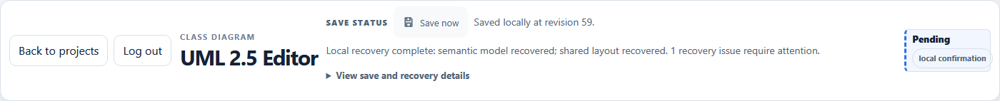

*Figura. Cabecera del editor con la identidad del proyecto y el aviso `Pending — local
confirmation`.*

**Evidencia medida:** la cola offline del teléfono se verificó leyendo la base de datos —la operación
aplica, sobrevive al cierre de la aplicación, sincroniza y **no duplica: una sola fila**—.

---

## 12. Importar y exportar XMI con Enterprise Architect

Importar y exportar viven en el **mismo diálogo** del editor. En la **barra de opciones** del espacio
de trabajo, el botón **XMI interchange** abre un diálogo con dos secciones: importar y exportar.
Ninguna de las dos modifica el modelo, y cada sección lo declara.

> **Corrección respecto de versiones anteriores de este documento.** Hasta el 2026-10-05 este
> apartado describía un menú **File** con las entradas *Import model file…* y *Export model file…*.
> **Ese menú no existe en este editor**: la barra superior solo tiene el nombre del producto y el
> enlace a la lista de proyectos. El texto describía otra interfaz, y sus capturas también. La
> exportación XMI existía en el backend pero **no tenía ninguna superficie en la interfaz** hasta que
> se agregó el panel descrito abajo.

### Importar

1. Pulsar **XMI interchange** en la barra de opciones. Se abre la sección **Import an XMI file**, que
   declara *"Preview only: reviewing this file does not change the project. The model changes only
   after you confirm import."*
2. En **Choose a file**, pulsar **Choose a file** y elegir el archivo. El propio control declara
   *"The backend detects and normalizes XMI. The editor changes only after confirmation."*
3. Revisar **Recognized content** con los elementos soportados, las advertencias y las **pérdidas**
   detectadas.
4. En **Choose how to import**, elegir el modo: **REEMPLAZAR — replace the existing model** o
   **AGREGAR — add alongside existing content**. **REEMPLAZAR** avisa que borra todo el contenido
   existente del modelo y que la acción no se puede deshacer.
5. Pulsar **Confirm import and replace existing model** o **Confirm import and add to existing
   model** (o **Cancel**). Solo entonces el editor cambia; un archivo inválido se rechaza sin tocar el
   proyecto, y el resultado queda en **Import result**.

### Exportar

6. En el mismo diálogo, bajar a la sección **Export the model as XMI**, que declara *"Download only:
   exporting this file does not modify the project. The model changes only through the editor or an
   import."*
7. Pulsar **Export XMI**. El archivo se **descarga** en el acto con el nombre derivado del nombre del
   proyecto y extensión `.xmi`, y el panel informa el **checksum SHA-256** que devuelve el servidor y
   las pérdidas en **Reported losses**.
8. El servidor emite el XMI del perfil **`Enterprise Architect 15.0.1514 / XMI 2.1`** y **registra el
   intercambio** asociado a la **revisión** de origen, marcándolo **PARTIAL** cuando hubo pérdidas.
   La exportación **se rechaza** si la versión del modelo no está en estado `VALID`, si hay colisiones
   de nombres o si el modelo no tiene una vista de diagrama por defecto.

### Ida y vuelta con Enterprise Architect

9. Se abre el XMI exportado en EA y se vuelve a exportar desde EA; el comparador verifica que se
   preservan identificadores, semántica soportada, relaciones y geometría representable.

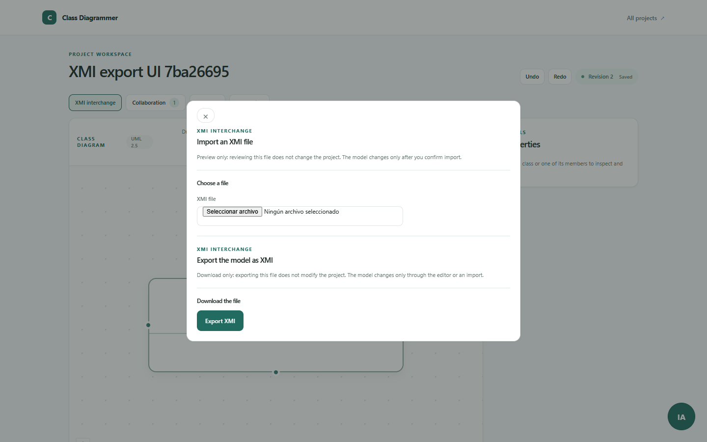

*Figura. El diálogo `XMI interchange` con sus dos secciones: `Import an XMI file` y `Export the model
as XMI`, separadas por una línea. Ambas se abren desde el botón **XMI interchange** de la barra de
opciones.*

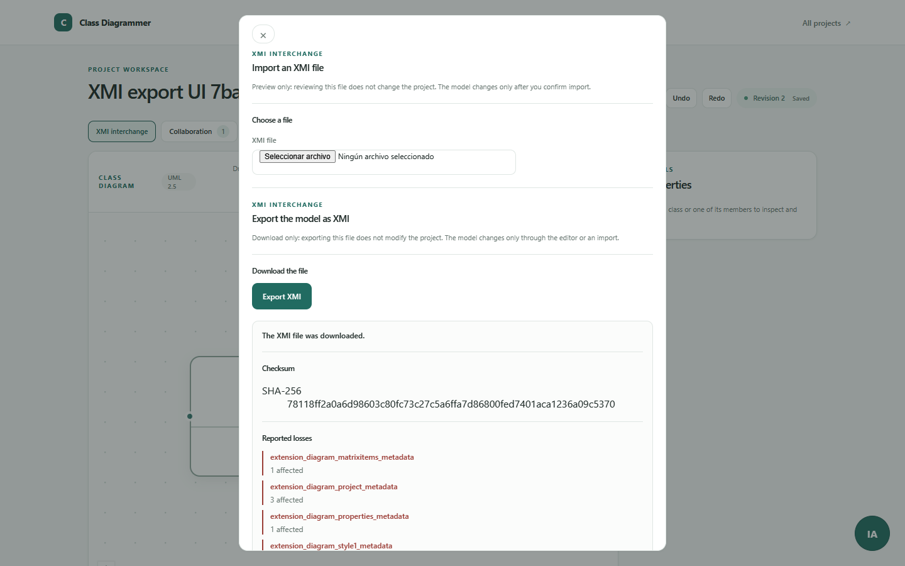

*Figura. Después de pulsar `Export XMI`: el archivo se descargó y el panel informa el checksum
**SHA-256** y las pérdidas que reportó el servidor.*

**Muestra real del artefacto:** `docs/capturas/xmi-export/XMI export UI 7ba26695.xmi` — los **1662
bytes** que el navegador descargó, **idénticos byte por byte** al documento que devuelve el servidor.
El nombre del archivo lo deriva el cliente del nombre del proyecto, porque el servidor no devuelve
nombre de archivo; eso está declarado a propósito y no se presenta como un dato del servidor.

**Fixture canónico:** `docs/fixtures/xmi/Prueba3.xml`.

---

## 13. Generar y verificar un backend

1. En el panel **Generación**, crear o seleccionar un destino y seleccionar un perfil.
2. Pulsar **Generar backend** y esperar a que termine; corregir los diagnósticos bloqueantes si aparecen.
3. Cuando esté listo, usar **Descargar ZIP** o **Implementar backend**. El backend generado no tiene autenticación y debe usarse solo en una red de confianza.
4. En una ejecución terminada, pulsar **Verificar generación**. El panel muestra cada comprobación como aprobada, fallida o no ejecutada y no presenta un resultado incompleto como verificación completa.

La verificación disponible inspecciona estructura, contenido de la migración, hashes, determinismo de artefactos y configuración. No ejecuta por corrida la compilación, el arranque, `health`, las pruebas o el contrato HTTP, Docker Compose ni la migración en PostgreSQL; tampoco verifica el comportamiento de seguridad, autorización o auditoría. Esas comprobaciones aparecen como **No ejecutada**. Las herramientas de extremo a extremo pueden aportar evidencia independiente, pero no convierten esas comprobaciones de la interfaz en ejecutadas.

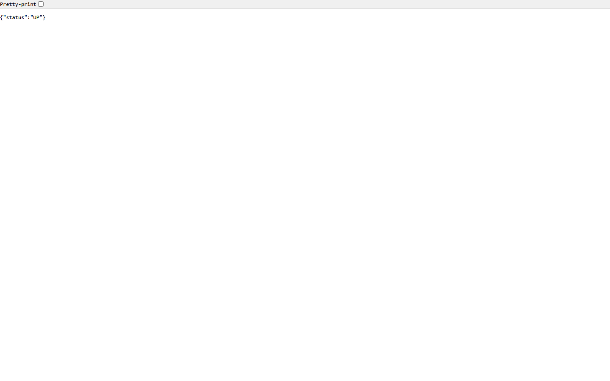

*Figura. Endpoint de salud del backend generado en ejecución
(`http://localhost:8094/actuator/health` → `{"status":"UP"}`).*

**Evidencia medida** (`tools/generation-e2e/REPORT.md`): dos corridas con el **mismo
`artifactZipHash`** (`7b239f01…ff452`), backend generado levantado en el puerto `8094` con su propia
base PostgreSQL 16.14 y `health` respondiendo `200` con `{"status":"UP"}`.

---

## 14. Consumir el backend desde Flutter

1. En el teléfono, abrir **Asistente** del despliegue correspondiente (por ejemplo `e2e-biblioteca`).
   La pantalla declara: *"Escriba qué desea hacer con los datos del despliegue"* y aclara que
   *"la interpretación usa el descriptor de este dominio y no envía la frase a un servicio externo"*.
2. Escribir la instrucción —por ejemplo *"crea Libro titulo Rayuela anio 1963 disponible true autorId
   Cortazar"*— y pulsar **Interpretar**. El botón **Vista manual** permite el alta manual si se
   prefiere.
3. Revisar el plan: **"Revise el plan completo"**, con el número de operaciones en orden y el detalle
   de cada paso (por ejemplo *"Paso 1: Libro — Crear"* con sus campos).
4. Confirmar. La escritura viaja contra el contrato del backend generado y queda en la base real, con
   las **claves foráneas resueltas**: cuando la referencia es única, la fila guarda el **UUID real** del
   registro referenciado.
5. Si una referencia es ambigua, el plan **no se puede confirmar todavía** y la aplicación lo dice
   con el motivo (*"No se encontró una coincidencia única para la referencia…"*), en lugar de
   inventar un valor.
6. Si el dispositivo no tiene reconocedor de voz instalado, la interfaz lo declara
   (*"Voz no disponible: el dispositivo no tiene un reconocedor de voz disponible…"*) y ofrece seguir
   escribiendo.

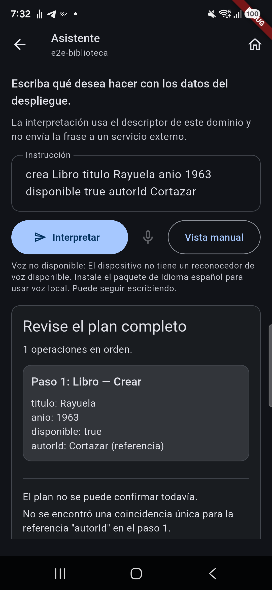

*Figura. Asistente del teléfono: instrucción escrita, aviso de voz no disponible, plan revisable y
el motivo por el que todavía no se puede confirmar.*

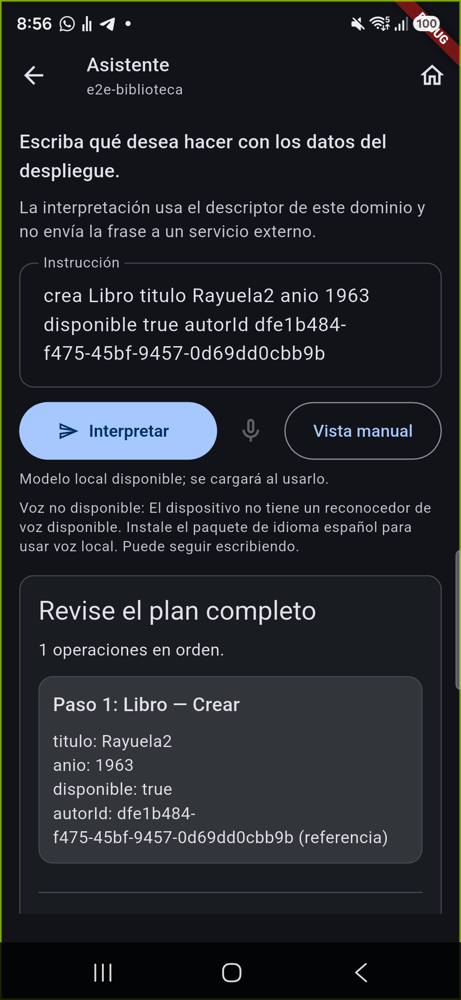

*Figura. Cuando la referencia es única, el plan se confirma y la fila queda ligada al UUID real del
registro referenciado.*

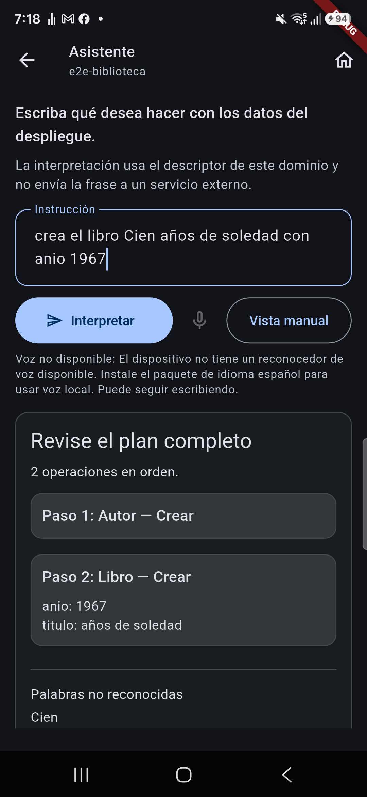

*Figura. Otra frase del recorrido del asistente sobre el mismo dominio.*

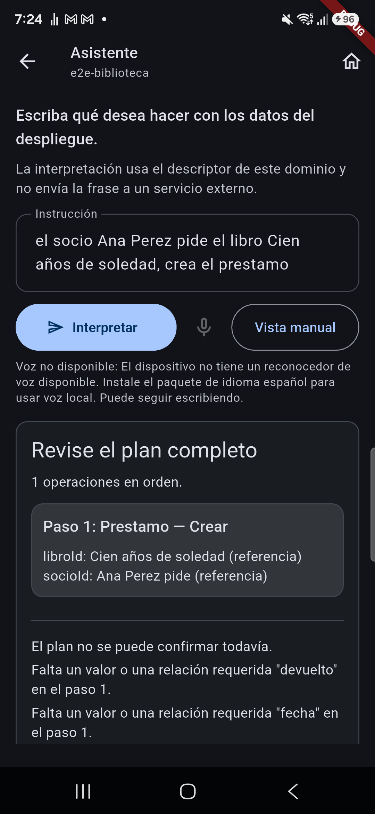

*Figura. Tercera frase del recorrido del asistente.*

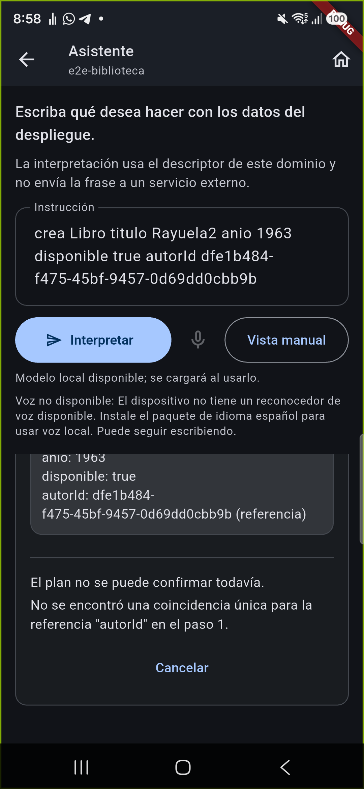

*Figura. Detalle desplazado de la misma pantalla, con la fila y su estado.*

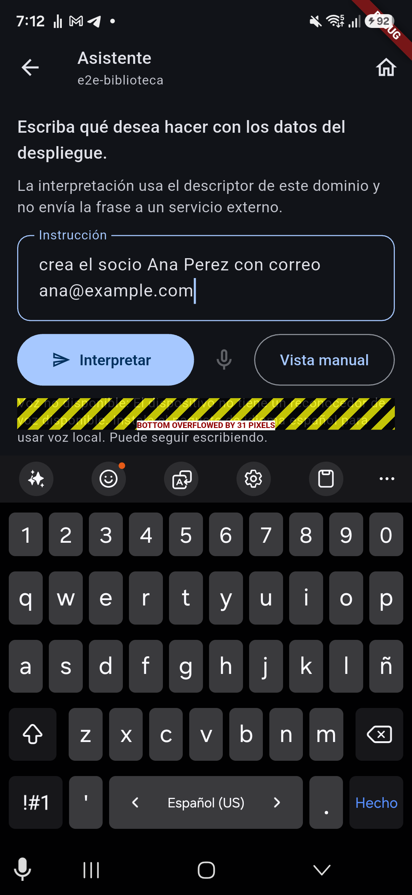

*Figura. Primera frase del recorrido del asistente.*

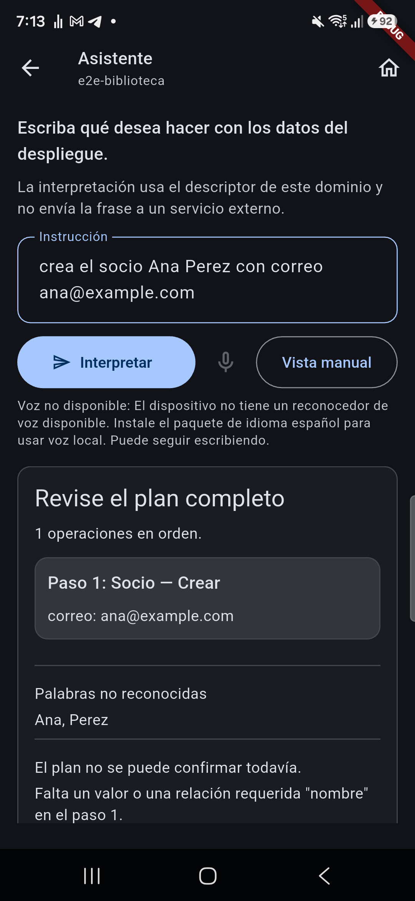

*Figura. La misma pantalla sin el teclado en pantalla.*

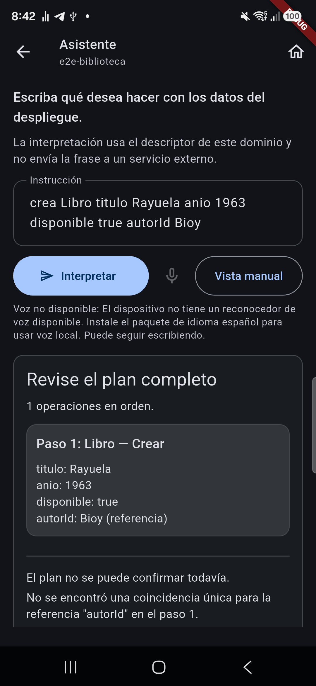

*Figura. Vista adicional del asistente durante el recorrido.*

---

## 15. Utilizar la IA local sin conexión

1. Cortar la conexión de datos del dispositivo.
2. Repetir la interacción del asistente. La aplicación declara que interpreta **con el descriptor del
   dominio**, sin enviar la frase a un servicio externo, y usa el **runtime local en el dispositivo**
   (lib_llama_cpp 0.7.3 sobre Qwen 3.5 0.8B).
3. Confirmar la escritura: queda marcada como **pendiente** en la cola local.
4. Al volver la red, la cola sincroniza **sin duplicar ni perder** resultados, y la fila deja de estar
   pendiente.
5. El runtime del teléfono es **independiente del runtime del backend**: no comparten proceso, caché
   ni memoria mutable.
6. Si la memoria o el almacenamiento del dispositivo no alcanzan, la interacción se bloquea **con
   diagnóstico** y nunca se muestra un éxito falso.

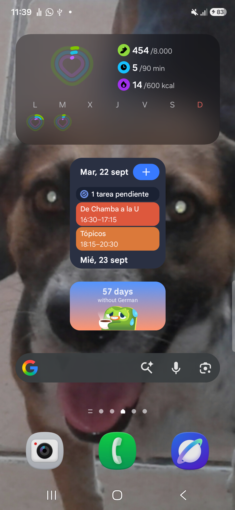

*Figura. Sesión medida del modelo local en el dispositivo, con la red cortada.*

**Evidencia medida:** en el dominio A el modelo local resolvió **2 de 3** frases que lo forzaron,
con el esquema del dominio y ejecutando consultas reales (29 y 28 tokens de salida), y la tercera la
rechazó la validación del dominio.

---

## 16. Ejecutar la demostración integral

El recorrido completo está guiado por el runbook `odd/demo-runbook.md` y su evidencia cruda queda en
`tools/e2e-integral/evidence/`.

1. **Preparar** el entorno: plataforma levantada, backend generado con su base, teléfono con la
   aplicación instalada y la red del dispositivo bajo control.
2. **Elegir el dominio en el momento**, sin clases preparadas de antemano.
3. **Modelar conversando**: pedir las clases y las relaciones a la asistencia por texto (operación 7).
4. **Exportar a XMI e importar en Enterprise Architect**, y reimportar el XMI de EA en un **proyecto
   nuevo** (operación 12).
5. **Generar el backend** desde el proyecto reimportado y desplegarlo con su propia base
   (operación 13).
6. **Ejecutar el CRUD desde el cliente** contra ese backend (operación 14).
7. **Medir el asistente del teléfono** con las frases congeladas del arnés, y **cortar la red** para
   el bloque en el dispositivo con la cola offline (operación 15).
8. **Presentar resultados, advertencias y límites sin ocultar pendientes**: los dominios B y C solo
   llegaron hasta la fase de ida y vuelta por EA, y la interacción exacta del asistente permanece
   abierta en Q9.

**Criterios de aceptación cubiertos en el dominio A: 9 de 9.**
**Recorrido medido:** 24/24 atributos con tipo y 7/7 asociaciones preservadas tras EA; backend
generado que compila, levanta y sirve su descriptor; despliegue `REGISTERED` en el puerto `8094`;
escrituras del asistente verificadas **leyendo la base**; préstamo guardado con los identificadores
reales del socio y del libro; cola offline sin duplicar.

Las capturas de esta operación son las ocho del asistente del teléfono
(`14-asistente-*.png`) junto con la evidencia de `tools/e2e-integral/evidence/20260922T063829Z-A/`.

---

## Notas para el pegado en el Word

1. Las capturas del editor son de **1440 × 900 px**; conviene **recortarlas** a la zona relevante (el
   panel o el lienzo) antes de insertarlas, porque a tamaño de página el texto de la interfaz queda
   pequeño.
2. Las capturas del teléfono son verticales (**1080 × 2340 px**): al insertarlas, dejarlas a un ancho
   de 6–7 cm para que entren dos por página.
3. El archivo `docs/capturas/uso/capturas-report.json` y `capturas-report-2.json` registran qué
   captura salió bien y en qué momento se tomó; sirven como trazabilidad si alguien pide la evidencia.
