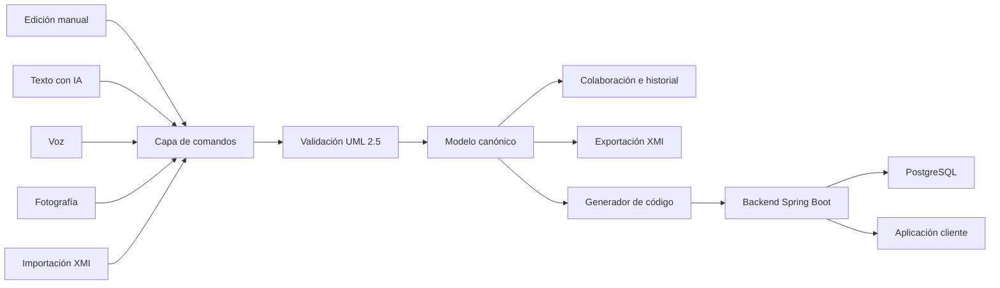

# Visión y alcance del Parcial I

> **Decisión de alcance:** el producto es un diagramador colaborativo de clases UML 2.5. Todos los requisitos mínimos enumerados por el docente son obligatorios; el orden de implementación puede variar, pero ninguno se considera opcional.

Este documento separa el contexto narrativo del producto que debe construirse, organiza los requisitos verificables y propone un enfoque técnico incremental.

## Lectura rápida

1. No se construirá el sistema nacional de salud descrito en el contexto.
2. Se construirá una herramienta CASE colaborativa centrada en diagramas de clases UML 2.5.
3. El modelo UML será la única fuente de verdad para la edición manual, la IA, la colaboración, XMI y la generación de código.
4. La herramienta generará un backend Spring Boot organizado en cuatro capas y configurado para PostgreSQL.
5. La demostración deberá cubrir edición manual, colaboración, IA por texto y voz, entrada mediante fotografía, interoperabilidad XMI, generación del backend y uso desde una aplicación cliente con IA local/sin conexión.

## Fuente y decisiones confirmadas

| Tema | Decisión |
| --- | --- |
| Fuente original | `D:\Vault\vault\Universidad\08-Semestre-8\Software I\01 - Apuntes\00 - Apuntes de Clase\Enunciado Parcial I.md` |
| Producto | Diagramador colaborativo de clases UML 2.5 |
| Alcance de modelado | El tipo central y obligatorio es el diagrama de clases UML 2.5. La mención a entidad-relación se interpreta como contexto sobre alternativas de diseño, no como un segundo editor independiente. |
| Requisitos enumerados | Todos son obligatorios. Pueden entregarse por incrementos, pero no descartarse como funcionalidades futuras u opcionales. |
| Backend | Spring Boot con un mínimo de cuatro capas |
| Base de datos | PostgreSQL |
| Diagramador inicial | React y TypeScript |
| Cliente móvil inicial | Flutter |
| Portabilidad del frontend | El backend y su contrato no dependerán de Flutter, React ni otro framework cliente. |
| Fecha indicada | 23 de septiembre; el enunciado no especifica el año |

## 1. Contexto del problema

El docente describe una empresa de desarrollo con más de cien ingenieros distribuidos en diferentes ciudades. La empresa analiza una licitación para digitalizar integralmente la gestión de salud de un país: citas, consultas, estudios, historias clínicas, atención remota e inteligencia artificial.

Una estimación inicial indica que veinte ingenieros experimentados necesitarían aproximadamente un año, mientras que el plazo contractual mencionado es considerablemente menor. La situación introduce tres problemas de ingeniería:

- coordinación de equipos distribuidos;
- productividad bajo presión de entrega;
- preservación de la calidad del proceso y del producto.

La respuesta académica no consiste en construir la plataforma nacional de salud. El contexto justifica la necesidad de una herramienta que ayude a los equipos a diseñar software de manera colaborativa y productiva.

## 2. Producto que debe construirse

El producto es una herramienta de desarrollo dirigida a diseñadores de software y bases de datos. Su responsabilidad principal es permitir que varias personas creen y modifiquen un diagrama de clases UML 2.5, tanto manualmente como mediante inteligencia artificial.

El diagrama deberá poder transformarse en un backend funcional e interoperar con Enterprise Architect mediante XMI.

### Definición breve

> Plataforma colaborativa de modelado UML 2.5 que recibe operaciones manuales, texto, voz, fotografías y archivos XMI; mantiene un modelo consistente y versionado; y genera un backend Spring Boot conectado a PostgreSQL.

### Límites del producto

El sistema no pretende:

- implementar el sistema nacional de salud descrito en el contexto;
- reemplazar todas las capacidades de Enterprise Architect;
- cubrir todo el ciclo de vida del desarrollo de software;
- generar automáticamente el frontend móvil completo;
- soportar otros diagramas UML mientras no sean requeridos expresamente.

## 3. Actores

| Actor | Responsabilidad |
| --- | --- |
| Diseñador | Crea y modifica el diagrama de clases. |
| Colaborador | Trabaja sobre el mismo proyecto desde otra ubicación y recibe cambios de los demás participantes. |
| Administrador del proyecto | Gestiona el proyecto, sus integrantes y los permisos básicos. |
| Asistente de IA | Interpreta texto, voz o imágenes y propone operaciones estructuradas sobre el modelo. |
| Generador de código | Transforma el modelo validado en un backend ejecutable. |
| Docente/evaluador | Proporciona un dominio durante la presentación y verifica el flujo integral. |
| Aplicación cliente | Consume el backend generado y demuestra un caso de uso del dominio. |

## 4. Flujo integral esperado



El principio central es que todos los mecanismos de entrada produzcan operaciones sobre el mismo modelo. La interfaz, la IA y los colaboradores no deben mantener representaciones independientes del diagrama.

## 5. Requisitos funcionales obligatorios

| ID | Requisito | Evidencia verificable |
| --- | --- | --- |
| RF-01 | Crear, abrir, guardar y gestionar proyectos de modelado. | Un usuario puede cerrar y recuperar un proyecto sin perder el modelo ni su disposición visual. |
| RF-02 | Crear diagramas de clases compatibles con UML 2.5. | El sistema representa los elementos y relaciones definidos en la línea base UML acordada. |
| RF-03 | Editar el diagrama manualmente. | El usuario puede crear, mover, editar y eliminar elementos desde la interfaz. |
| RF-04 | Trabajar colaborativamente. | Dos o más usuarios observan y editan el mismo proyecto, con cambios sincronizados y conflictos controlados. |
| RF-05 | Editar mediante IA conversacional. | Instrucciones como “crea una clase”, “mueve la clase” o “relaciona A con B” modifican el modelo existente. |
| RF-06 | Mantener ambos modos de edición. | Una operación realizada por IA puede continuar manualmente y viceversa, sin divergencia del modelo. |
| RF-07 | Recibir comandos de voz. | El habla se convierte en una operación validada sobre el modelo. |
| RF-08 | Interpretar una fotografía. | Una imagen de un modelo produce una propuesta editable; el usuario puede confirmarla o corregirla antes de aplicarla. |
| RF-09 | Importar y exportar XMI. | Un modelo puede intercambiarse con la versión acordada de Enterprise Architect conservando los elementos soportados. |
| RF-10 | Generar un backend desde el diagrama. | El proyecto generado compila, inicia y expone las operaciones acordadas para el dominio modelado. |
| RF-11 | Generar la configuración necesaria. | El resultado incluye dependencias, configuración de PostgreSQL y estructura mínima de cuatro capas. |
| RF-12 | Permitir una demostración con un dominio no codificado previamente. | Durante la presentación puede modelarse un caso propuesto por el docente y generarse su backend. |
| RF-13 | Consumir el backend desde una aplicación cliente. | El cliente inicial en Flutter —o un frontend alternativo solicitado— ejecuta al menos un flujo completo sin modificar el backend generado. |
| RF-14 | Incorporar IA en la aplicación demostrativa. | La aplicación cliente utiliza IA en una interacción relevante para el dominio. |
| RF-15 | Mantener disponible la IA sin conexión. | La interacción de IA definida para el modo local continúa funcionando cuando no existe conectividad. |

## 6. Línea base de UML 2.5

La afirmación “compatible con UML 2.5” necesita una línea base explícita. Para un diagramador de clases orientado a generación de backend, como mínimo debe evaluarse el siguiente conjunto:

### Clasificadores

- clase;
- clase abstracta;
- interfaz;
- enumeración;
- paquete.

### Características

- atributos;
- operaciones;
- parámetros y tipos;
- visibilidad: pública, privada, protegida y de paquete;
- miembros estáticos;
- miembros abstractos;
- valores predeterminados.

### Relaciones

- asociación;
- agregación;
- composición;
- generalización/herencia;
- realización de interfaz;
- dependencia;
- multiplicidad;
- roles y navegabilidad.

### Elementos complementarios

- notas y restricciones;
- estereotipos necesarios para la generación;
- identificadores estables para colaboración y XMI;
- información de disposición visual separada de la semántica UML.

Esta línea base debe validarse con el docente. “UML 2.5 completo” podría abarcar una superficie mucho mayor que la necesaria para el parcial; la herramienta debe declarar con precisión qué subconjunto implementa sin atribuirse compatibilidad no demostrada.

## 7. Modelo conceptual interno

El diagramador necesita un modelo semántico independiente del lienzo visual. Una estructura inicial puede incluir:

| Concepto | Responsabilidad |
| --- | --- |
| `Project` | Agrupa el modelo, colaboradores, versiones y configuración de generación. |
| `Diagram` | Mantiene la vista y la disposición visual. |
| `Classifier` | Base semántica para clases, interfaces y enumeraciones. |
| `Property` | Representa atributos, tipos, visibilidad y multiplicidad. |
| `Operation` | Representa métodos y parámetros. |
| `Relationship` | Representa asociaciones, composición, herencia y otras relaciones UML. |
| `ModelCommand` | Operación atómica validada sobre el modelo. |
| `ModelVersion` | Revisión consistente utilizada por colaboración, historial y generación. |
| `ProjectMember` | Usuario, rol y permisos dentro de un proyecto. |
| `GenerationProfile` | Define reglas y opciones para producir el backend. |
| `GeneratedArtifact` | Registra el resultado y la versión del modelo que lo originó. |

El lienzo guarda posición, tamaño y estilo. El modelo semántico guarda clases, atributos y relaciones. Separarlos evita que un cambio visual altere accidentalmente la generación de código.

## 8. Arquitectura recomendada

### 8.1 Núcleo de modelado

Responsable de las reglas UML, los identificadores estables y las invariantes. No debe depender de la interfaz, del proveedor de IA ni de XMI.

### 8.2 Capa de comandos

Toda modificación debe expresarse como un comando, por ejemplo:

- `CreateClass`;
- `RenameClassifier`;
- `AddAttribute`;
- `CreateRelationship`;
- `MoveElement`;
- `DeleteElement`.

La capa valida precondiciones, aplica la operación, registra el resultado y permite deshacer cuando corresponda.

### 8.3 Colaboración

Una implementación inicial puede usar:

- servidor autoritativo;
- WebSockets para presencia y propagación de cambios;
- versión global del proyecto y versión por elemento;
- registro ordenado de comandos;
- bloqueo optimista y resolución explícita de conflictos;
- historial y restauración de versiones.

Un CRDT solo se justifica si se exige edición simultánea del mismo elemento sin coordinación. Introducirlo sin esa necesidad aumentaría considerablemente la complejidad.

### 8.4 Asistente de IA

La IA no debe modificar directamente la base de datos ni el lienzo. Su salida debe cumplir un esquema de comandos estructurados:

```json
{
  "command": "CreateRelationship",
  "sourceId": "customer",
  "targetId": "appointment",
  "relationshipType": "association",
  "sourceMultiplicity": "1",
  "targetMultiplicity": "0..*"
}
```

El sistema valida el comando, muestra una previsualización cuando sea ambiguo o destructivo y solo entonces lo aplica.

### 8.5 Voz y fotografía

La voz y la fotografía son adaptadores de entrada, no núcleos independientes:

```text
Voz -> reconocimiento de habla -> texto -> IA -> comando UML
Foto -> visión/OCR -> propuesta de elementos -> validación humana -> comandos UML
```

Una fotografía nunca debería sobrescribir el modelo automáticamente. Debe generar un borrador revisable.

### 8.6 Generador de backend

El generador debe seguir una tubería determinista:

```text
Modelo UML
  -> validación semántica
  -> modelo intermedio de generación
  -> plantillas/versiones
  -> proyecto Spring Boot
  -> compilación y pruebas
```

Mapeo inicial sugerido:

| UML | Backend generado |
| --- | --- |
| Clase persistente | Entidad JPA |
| Atributo | Campo tipado y validación |
| Asociación | Relación y clave foránea |
| Multiplicidad | Anotación JPA correspondiente |
| Enumeración | `enum` de Java |
| Generalización | Estrategia de herencia configurada |
| Restricción | Validación cuando exista una equivalencia soportada |

Las cuatro capas mínimas deberían quedar definidas como:

1. dominio/entidades;
2. repositorios;
3. servicios/aplicación;
4. controladores/API.

DTO, mapeadores, configuración y migraciones son componentes de apoyo. La composición exacta debe acordarse antes de fijar las plantillas.

### 8.7 Interoperabilidad XMI

XMI no es un formato universal sin variaciones. La compatibilidad depende de la versión de XMI, la versión de UML y las extensiones del proveedor.

Antes de implementar el adaptador se necesita:

1. confirmar la versión de Enterprise Architect usada en la evaluación;
2. obtener archivos XMI de ejemplo exportados por esa versión;
3. definir qué elementos deben conservarse en un viaje de ida y vuelta;
4. separar datos semánticos UML de extensiones visuales específicas de Enterprise Architect.

### 8.8 Contrato independiente del frontend

Flutter será el cliente móvil inicial, pero no formará parte del contrato del backend. Cualquier frontend deberá poder reemplazarse sin regenerar ni modificar la lógica de negocio.

Para lograrlo, el backend generado debe ofrecer:

- API HTTP/JSON versionada;
- especificación OpenAPI generada junto con el proyecto;
- DTO y errores independientes de la interfaz;
- autenticación, paginación y validaciones expresadas en el contrato;
- configuración externa de orígenes permitidos;
- posibilidad de generar SDK clientes para Dart, TypeScript u otros lenguajes.

Cada frontend encapsulará el acceso en un repositorio o cliente API. Las reglas del negocio permanecerán en el backend; la navegación, presentación, estado visual y almacenamiento específico del dispositivo permanecerán en el cliente.

Esta separación permite utilizar Flutter inicialmente y reemplazarlo por React Native, React, Angular, Vue, una aplicación de escritorio o cualquier otro cliente compatible con HTTP/OpenAPI.

## 9. Requisitos de calidad

| ID | Atributo | Criterio inicial |
| --- | --- | --- |
| RNF-01 | Consistencia | Todos los clientes observan una versión válida del modelo. |
| RNF-02 | Trazabilidad | Cada cambio registra autor, momento, comando y versión. |
| RNF-03 | Recuperación | El usuario puede deshacer operaciones y recuperar una versión anterior. |
| RNF-04 | Determinismo | El mismo modelo y perfil producen el mismo backend. |
| RNF-05 | Interoperabilidad | Los elementos UML acordados sobreviven al intercambio XMI. |
| RNF-06 | Seguridad | Los usuarios solo acceden y modifican proyectos autorizados. |
| RNF-07 | Usabilidad | Las operaciones manuales frecuentes no dependen de la IA. |
| RNF-08 | Rendimiento | Los cambios colaborativos se reflejan con latencia apta para interacción. |
| RNF-09 | Extensibilidad | Nuevos proveedores de IA y formatos se agregan mediante adaptadores. |
| RNF-10 | Disponibilidad local | La capacidad de IA definida para modo sin conexión no depende de servicios remotos. |
| RNF-11 | Portabilidad del cliente | Un frontend alternativo consume el mismo contrato sin modificar la lógica del backend. |

## 10. Escenario de aceptación integral

La demostración final debería probar el sistema como una secuencia única:

1. El docente proporciona un dominio, por ejemplo clínica, restaurante o barbería.
2. Se crea un proyecto nuevo.
3. Dos usuarios ingresan al mismo proyecto.
4. El primer usuario crea manualmente clases, atributos y relaciones.
5. El segundo usuario observa los cambios y modifica otro elemento.
6. Una instrucción textual agrega o corrige una parte del modelo existente.
7. Un comando de voz ejecuta otra modificación.
8. Una fotografía produce una propuesta que el usuario revisa y confirma.
9. El modelo se exporta a XMI y se verifica en Enterprise Architect.
10. El diagrama genera un backend Spring Boot de cuatro capas.
11. El backend compila, inicia y se conecta a PostgreSQL.
12. Se ejecuta un flujo funcional desde Postman o desde la aplicación cliente.
13. La aplicación móvil demuestra la interacción con IA acordada.
14. Se desconecta la red y se verifica que la IA local requerida permanece disponible.

Este escenario evita demostraciones aisladas que no prueben la integración real entre las capacidades.

## 11. Estrategia incremental

Todos los incrementos forman parte del alcance obligatorio. La secuencia reduce riesgo; no convierte requisitos en opcionales.

### Incremento 0 — Contrato y pruebas de riesgo

- cerrar la línea base UML 2.5;
- conseguir muestras XMI de Enterprise Architect;
- probar una transformación mínima de UML a Spring Boot;
- validar la viabilidad de voz, visión e IA local en el hardware objetivo.

### Incremento 1 — Modelo y editor manual

- modelo canónico;
- comandos básicos;
- lienzo visual;
- persistencia de proyectos;
- validaciones UML.

### Incremento 2 — Generación vertical

- dos clases relacionadas;
- entidades, repositorios, servicios y controladores;
- configuración PostgreSQL;
- compilación y prueba del CRUD generado.

### Incremento 3 — Colaboración

- usuarios y proyectos compartidos;
- sincronización en tiempo real;
- presencia, versiones, historial y conflictos.

### Incremento 4 — IA textual

- lenguaje natural a comandos;
- referencias a elementos existentes;
- previsualización, confirmación y deshacer;
- manejo de instrucciones ambiguas.

### Incremento 5 — Interoperabilidad

- importación XMI;
- exportación XMI;
- pruebas de ida y vuelta con Enterprise Architect.

### Incremento 6 — Multimodal y modo local

- comandos de voz;
- interpretación de fotografías;
- IA local/sin conexión;
- sincronización posterior cuando corresponda.

### Incremento 7 — Aplicación y presentación

- cliente Flutter o React Native;
- escenario funcional completo;
- dominio no codificado de antemano;
- ensayo de presentación y recuperación ante fallos.

## 12. Riesgos principales

| Riesgo | Consecuencia | Mitigación temprana |
| --- | --- | --- |
| Interpretar “UML 2.5” como compatibilidad total | Alcance incontrolable | Acordar y documentar el subconjunto evaluado. |
| Incompatibilidad con el XMI de Enterprise Architect | Falla de interoperabilidad en la presentación | Trabajar desde archivos reales y pruebas de ida y vuelta. |
| Salidas no deterministas de la IA | Corrupción o ambigüedad del modelo | Limitar la IA a comandos validados y confirmables. |
| Conflictos de edición concurrente | Pérdida de cambios | Versiones, comandos atómicos e historial desde el inicio. |
| Generación de código no compilable | Se rompe el flujo principal | Compilar y probar cada plantilla automáticamente. |
| IA local demasiado pesada | No funciona en el dispositivo objetivo | Prototipo temprano con límites de memoria, latencia y almacenamiento. |
| Tratar voz y fotografía como productos separados | Duplicación de lógica | Convertir todas las entradas a la misma capa de comandos. |
| Preparar una demo hardcodeada | No responde al dominio elegido por el docente | Probar periódicamente con dominios distintos. |

## 13. Decisiones que aún deben cerrarse

Estas decisiones no reducen el alcance obligatorio; definen cómo comprobarlo:

1. subconjunto exacto de UML 2.5;
2. significado preciso de las cuatro capas;
3. operaciones CRUD y reglas que forman un “backend completo”;
4. versión de Enterprise Architect y dialecto XMI;
5. nivel de simultaneidad y estrategia esperada para conflictos;
6. ubicación exacta de la IA sin conexión: diagramador, aplicación móvil o ambos;
7. resultado esperado de una fotografía: diagrama completo o borrador parcial;
8. plataforma y hardware utilizados durante la exposición;
9. alcance funcional que deberá demostrar la aplicación Flutter o React Native;
10. plazo correcto del contexto: seis días o seis meses.

## 14. Definición de terminado

El parcial estará terminado cuando pueda comprobarse lo siguiente:

- [ ] El sistema crea y persiste diagramas de clases conforme a la línea base UML 2.5 acordada.
- [ ] Todas las operaciones principales existen en modo manual.
- [ ] Dos o más usuarios colaboran sin perder cambios.
- [ ] La IA modifica el modelo existente mediante comandos estructurados.
- [ ] Los comandos de voz usan el mismo flujo de validación.
- [ ] Una fotografía se transforma en una propuesta editable.
- [ ] La importación y exportación XMI funcionan con Enterprise Architect.
- [ ] El backend generado contiene las cuatro capas acordadas.
- [ ] El backend compila, inicia y utiliza PostgreSQL.
- [ ] Una aplicación cliente consume un flujo funcional.
- [ ] La interacción de IA definida funciona sin conexión.
- [ ] La demostración puede ejecutarse con un dominio elegido durante la presentación.

## Próximo paso

Convertir esta visión en casos de uso y criterios de aceptación detallados antes de definir la arquitectura física o comenzar la implementación. La prioridad inmediata debe ser cerrar la línea base UML 2.5 y ejecutar las pruebas de riesgo de XMI, generación e IA local.
